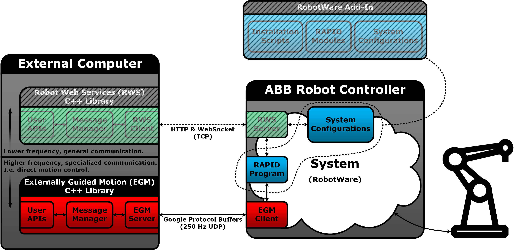
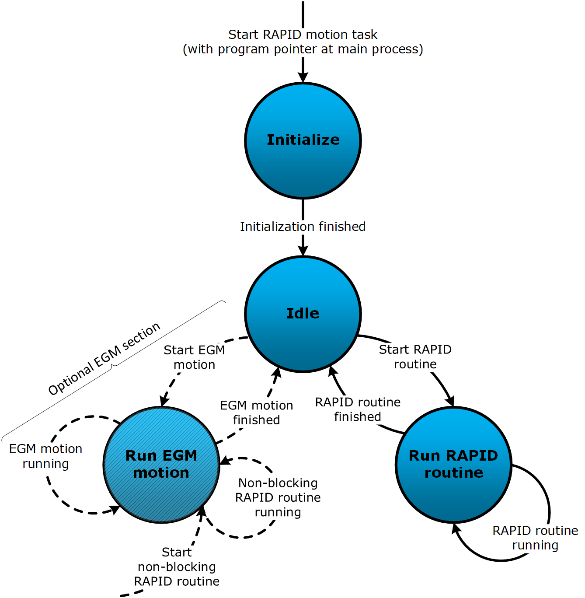

# ba7lya.abb.robot.egm

## Overview

A C++ library for interfacing with ABB robot controllers supporting *Externally Guided Motion* (EGM). See the *Application manual - Externally Guided Motion* (document ID: `3HAC073319-001`, revision: `B`) for a detailed description of what EGM is and how to use it.

* See StateMachine Add-In ([1.0](https://robotapps.robotstudio.com/#/viewApp/7fa7065f-457f-47ce-98d7-c04882e703ee) or [1.1](https://robotapps.robotstudio.com/#/viewApp/c163de01-792e-4892-a290-37dbe050b6e1)) for an optional *RobotWare Add-In* that can be useful when configuring an ABB robot controller for use with this library.

Please note that this package has not been productized, it is provided "as-is" and only limited support can be expected.

### Sketch

The following is a conceptual sketch of how this EGM library can be viewed, in relation to an ABB robot controller. The optional *StateMachine Add-In* is related to the robot controller's RAPID program and system configuration.

### Requirements

* RobotWare version `6.07.01` or higher (lower versions are incompatible due to changes in the EGM communication protocol).
* A license for the RobotWare option *Externally Guided Motion* (`689-1`).

### Dependencies

* [standalone asio](https://think-async.com/Asio/) (non-Boost variant)
* [Google Protocol Buffers](https://developers.google.com/protocol-buffers)

### Limitations

This library is intended to be used with the UDP variant of EGM, and it supports the following EGM modes:

* Joint Mode
* Pose Mode

### Recommendations

* This library has been verified to work with RobotWare version `6.08.00.01`. Other versions are expected to work, except versions older than RobotWare `6.07.01` which are incompatible due to changes in the EGM communication protocol.
* It is a good idea to perform RobotStudio simulations before working with a real robot.
* It is prudent to familiarize oneself with general safety regulations (e.g. described in ABB manuals).
* Consider cyber security aspects, before connecting robot controllers to networks.

## Usage Hints

This is a generic library, which can be used together with any RAPID program that is using the RAPID `EGMRunJoint` and/or `EGMRunPose` instructions, and system configuration. The library's primary classes are:

* [UDPServer](include/udp_server.hxx): Sets up and manages asynchronous UDP communication loops. During an EGM communication session, the robot controller requests new references over a UDP channel, at the rate specified with RAPID `EGMAct` instructions. When an `UDPServer` instance receives an EGM message from the robot controller the message is passed on to an EGM interface instance (see below). The interface is expected to generate the reply message, containing the new references, which the server then sends back to the robot controller.
* [AbstractUDPServerInterface](include/udp_server.hxx): An abstract interface, which specifies how to interact with the `UDPServer` class. Can be inherited from to implement custom EGM interfaces.
* [EGMBaseInterface](include/base_interface.hxx): Inherits from `AbstractUDPServerInterface`, encapsulates an `UDPServer` instance, and implements a basic EGM interface. Can be configured to use demo references, which are intended for testing that EGM communication channels works.
* [EGMControllerInterface](include/controller_interface.hxx): Inherits from `EGMBaseInterface` and implements an EGM interface variant for execution inside an external control loop that needs to be implemented by the user. Provides interaction methods, which can be used inside external control loops to affect EGM communication sessions.
* [EGMTrajectoryInterface](include/trajectory_interface.hxx): Inherits from `EGMBaseInterface` and implements an EGM interface variant for execution of a queue of trajectories. Provides interaction methods, which can be called by a user to for example add trajectories to the queue and to stop/resume the trajectory execution.

The optional *StateMachine Add-In* for RobotWare can be used in combination with any of the classes above.

### StateMachine Add-In [Optional]

The purpose of the RobotWare Add-In is to *ease the setup* of ABB robot controllers. It is made for both *real controllers* and *virtual controllers* (simulated in RobotStudio). If the Add-In is selected during a RobotWare system installation, then the Add-In will load several RAPID modules and system configurations based on the system specifications (e.g. number of robots and present options).

The RAPID modules and configurations constitute a customizable, but ready to run, RAPID program which contains a state machine implementation. Each motion task in the robot system receives its own state machine instance, and the intention is to use this in combination with external systems that require interaction with the robot(s). The following is a conceptual sketch of the RAPID program's execution flow.

  

To install the Add-In:

1. Go to the *Add-Ins* tab in RobotStudio.
2. Search for *StateMachine Add-In* in the *RobotApps* window.
3. Select the desired Add-In version and retrieve it by pressing the *Add* button.
4. Verify that the Add-In was added to the list *Installed Packages*.
5. The Add-In should appear as an option during the installation of a RobotWare system.

See the Add-In's user manual ([1.0](https://robotapps.blob.core.windows.net/appreferences/docs/27e5bd15-b5ec-401d-986a-30c9d2934e97UserManual.pdf) or [1.1](https://robotapps.blob.core.windows.net/appreferences/docs/cd504500-80e2-4cb6-9419-c60ea4ad6d56UserManual.pdf)) for more details, as well as for install instructions for RobotWare systems. The manual can also be accessed by right-clicking on the Add-In in the *Installed Packages* list and selecting *Documentation*.

#### Notes

If the EGM option is selected during system installation, then the Add-In will load RAPID code for using `EGMRunJoint` and `EGMRunPose` RAPID instructions. System configurations will also be loaded, and it is important to update the robot controller's EGM configurations. Especially the *Remote Address* and *Remote Port Number* configurations, under the *Transmission Protocol* topic, are vital to edit so that the robot controller will send EGM messages to the correct host address. This configuration can be found in RobotStudio -> Controller tab -> Configuration -> Communication -> Transmission Protocol -> Edit each `ROB_X` instance. There will be one instance for each robot in the system.
